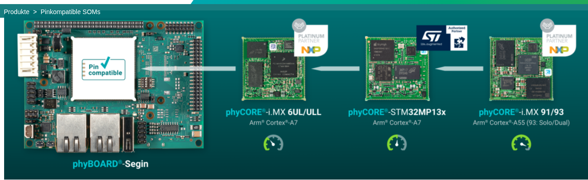
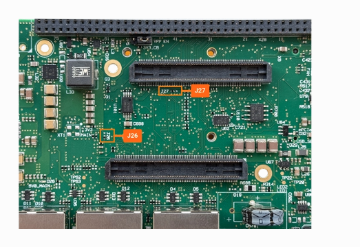
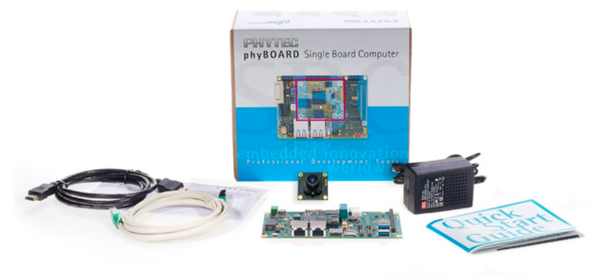

.. START:section:0:0
**Purpose and scope**
=====================

.. END:section:0:0

.. START:main_content:0:0
This document introduces the basic hardware concepts required when working with PHYTEC development boards. It covers:
    • Basic SOM removal and installation precautions.
    • Identification of the SOM, carrier board, connectors and peripherals.
    • PHYTEC board families and their power-supply requirements.
    • Official PHYTEC documentation sources for hardware verification.

.. END:main_content:0:0

**Understanding the hardware**
~~~~~~~~~~~~~~~~~~~~~~~~~~~~~~

**System-on-Module (SOM)**  

A System-on-Module is a compact computer module that integrates the main processing components. Depending on the model, it may include:
    
Processor or system-on-chip (SoC).   
RAM
Non-volatile storage.
Power-management
supporting circuitry.
    
Interfaces routed to a module connector.
    
The exact components depend on the SOM model.
    
How to identify a SOM:
   
Look for the phyCORE product name. 
   
Record the product number and module variant. 
Record the PCB revision. 
Find the matching SOM hardware manual on the official PHYTEC website. 

Use the manual's component-placement diagram to identify the components.
    

.. START:image:0:0:1

.. END:image:0:0:1

|

**Carrier board**

The carrier board provides the physical interfaces and supporting circuitry required to use the SOM in a complete system.
Depending on the carrier-board model, it may provide:
• Power input.
• Ethernet.
• USB.
• UART, RS-232 or RS-485.
• CAN.
• I²C and SPI expansion interfaces.
• GPIO and PWM.
• Display, camera and audio interfaces.
• MicroSD or other storage connections.
Not every carrier board exposes every processor interface.
How to identify a carrier board:
Look for the phyBOARD product name, where applicable.
Record the carrier-board product number and PCB revision.
Find the corresponding carrier-board hardware manual.
Compare the board with the component-placement diagram.
Match the connector labels and reference designators to the manual.

.. START:image:0:0:4

   Fig 2 : Ex AM64 Carrier Board

.. END:image:0:0:4

|

**Complete development kit**
~~~~~~~~~~~~~~~~~~~~~~~~~~~~

A development kit commonly combines a SOM, carrier board and accessories.

The external power input for the complete kit may differ from the voltage required by the SOM itself because the carrier board may contain voltage regulators

Important: Never assume that the SOM supply voltage is also the correct external input voltage for the complete development kit.

.. START:image:0:0:6

   Fig 3 :  ex - phyBOARD®-Pollux
   Imaging kit

.. END:image:0:0:6

|

**SOM removal and installation precautions**
~~~~~~~~~~~~~~~~~~~~~~~~~~~~~~~~~~~~~~~~~~~~

The correct extraction tool and mechanical procedure depend on the SOM connector and carrier-board design.

**Before removing the SOM** 

1.Shut down the operating system using the documented procedure. 
2. Disconnect the external power supply.
3. Disconnect other connections that could back-power the board, where applicable.
4. Confirm the board is no longer powered before handling the module. 
5. Use appropriate electrostatic discharge (ESD) protection, such as a grounded ESD wrist strap and ESD-safe work surface. 
6. Identify the exact SOM and carrier board. 
7. Read the relevant PHYTEC hardware manual and identify the required removal tool.    

**During removal**
    
• Use the correct removal tool for the specific SOM connector.
• Follow the prescribed removal points and procedure 
• Apply controlled, even force.
• Do not twist or bend the module.
• Do not pull on components or use nearby components as leverage. • Stop if the module does not release as expected.
    

**During installation** 

1.Inspect the module and connector for visible damage or contamination.
2. Confirm the correct orientation.
3. Align the SOM with the carrier-board connector.
4. Seat the module evenly using the method specified by PHYTEC. 5. Do not force a misaligned connector.
6. Inspect the assembly before reconnecting power.
7. Reconnect power only after the module is correctly installed.
    
**SOM removal video**   

The following video was supplied as a visual reference for the removal procedure.
    
Watch the SOM removal procedure on YouTube

Use the video together with the applicable PHYTEC hardware manual.   

The manual for the exact module and carrier-board combination should determine the tool and handling procedure.

**Identifying connectors and peripherals**
    
Use the official carrier-board component-placement diagram and hardware manual to identify the connectors.
